<p align="center">
  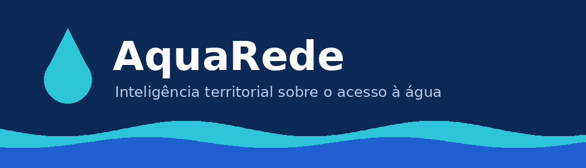
</p>

<h1 align="center">AquaRede</h1>
<p align="center"><b>Painel de inteligência territorial que antecipa problemas de acesso à água na Grande São Paulo, juntando reservatórios, clima e relatos dos moradores.</b></p>

---

## 1. Problema e público

**Problema.** Na Região Metropolitana de São Paulo, a falta de água costuma chegar primeiro aos bairros periféricos e às partes altas da cidade. Os sinais aparecem antes: reservatórios caindo, semanas sem chuva, calor aumentando o consumo e moradores relatando falta d'água. Mas essas informações ficam espalhadas e não chegam juntas a quem decide.

**Para quem.**
- **Gestores públicos** (subprefeituras, defesa civil, áreas de saneamento): acompanham indicadores, recebem alertas justificados e registram a decisão humana sobre cada um.
- **Cidadãos e associações de bairro**: acompanham a situação e registram ocorrências anônimas.

**Impacto social esperado.** Antecipar situações de falta de água e de água contaminada para que equipes cheguem antes nos bairros mais vulneráveis. O app mostra o indicador **"Pessoas em alertas antecipados"**, que soma os moradores afetados em bairros que já geraram alerta para os gestores, e **"Alertas com decisão humana"**, que mostra quantos alertas já foram avaliados por uma pessoa e quantas pessoas estão nos casos encaminhados.

**ODS relacionados:** ODS 6 (Água potável e saneamento) e ODS 11 (Cidades e comunidades sustentáveis).

## 2. Integrantes

| Nome completo | RM |
|---|---|
| _GUSTAVO CORDEIRO BRAGA_ | _RM562247_ |
| _KAIO CORREA FERNANDES DA CONCEIÇÃO_ | _RM563443_ |

## 3. Demonstração visual

| | | |
|---|---|---|
| 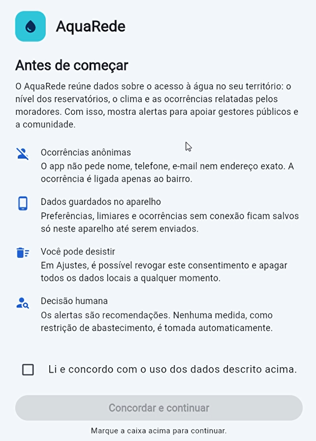<br>Consentimento explícito | 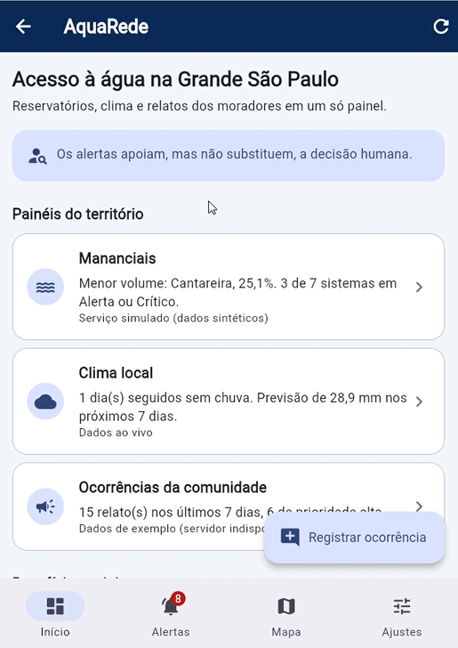<br>Visão geral do território | 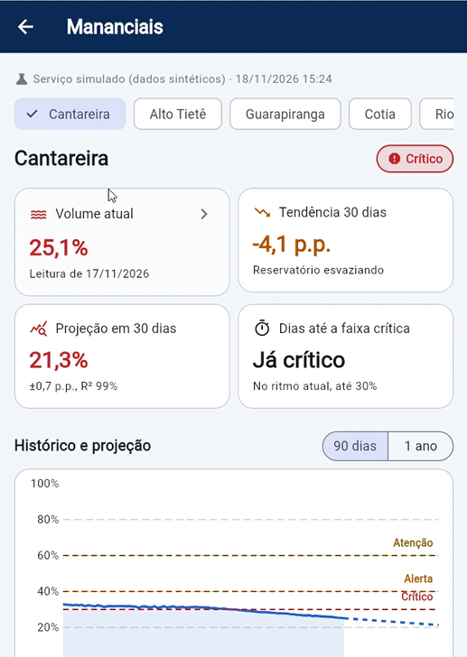<br>Painel de mananciais |
| 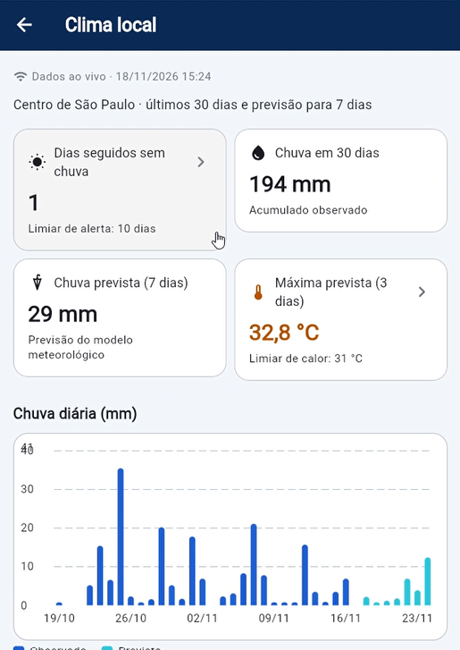<br>Painel de clima (dados reais) | 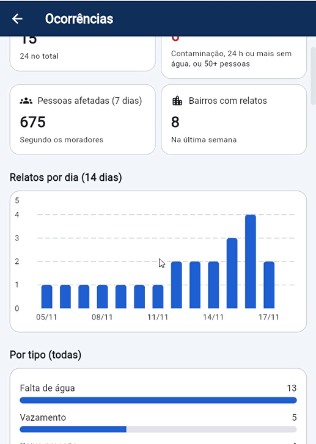<br>Painel de ocorrências | 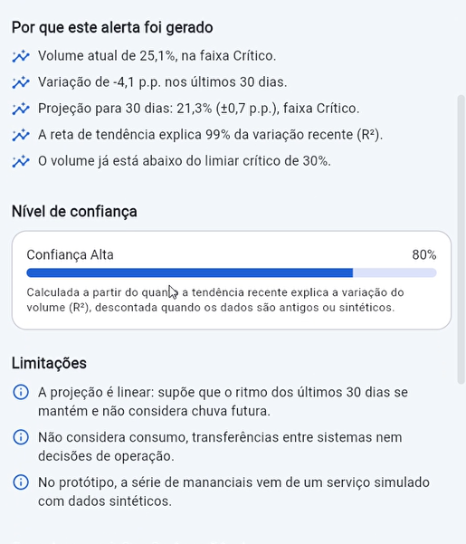<br>Detalhe do indicador |
| 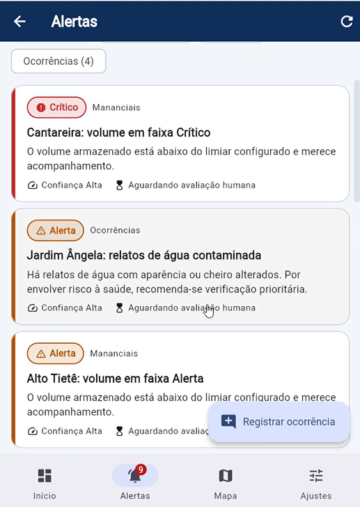<br>Lista de alertas | 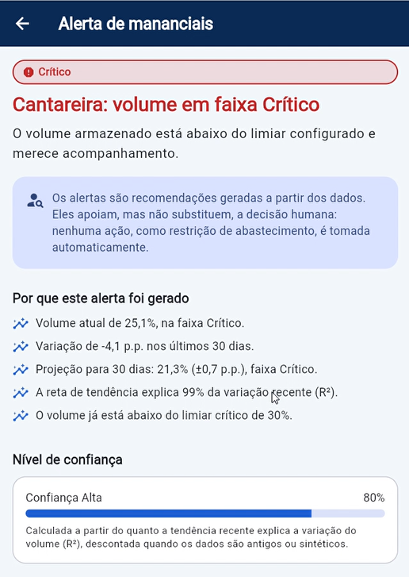<br>Justificativa, confiança e limitações | 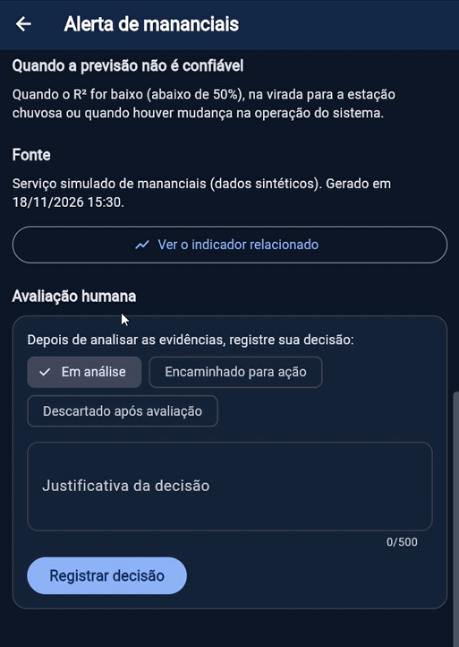<br>Decisão humana do gestor |
| 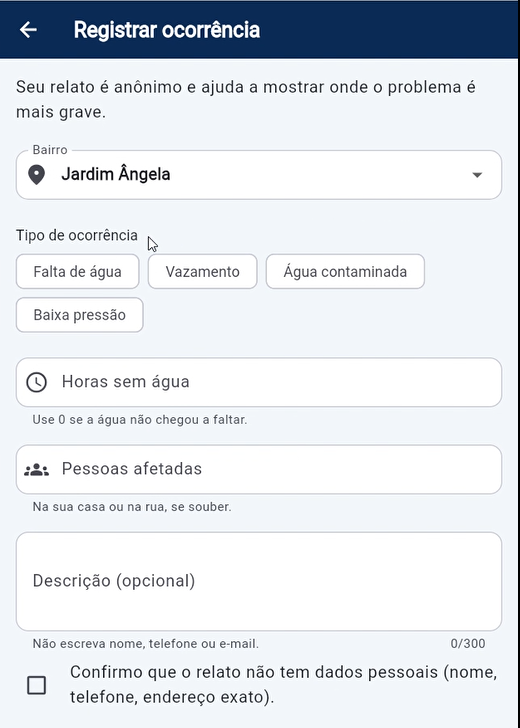<br>Formulário com validação | 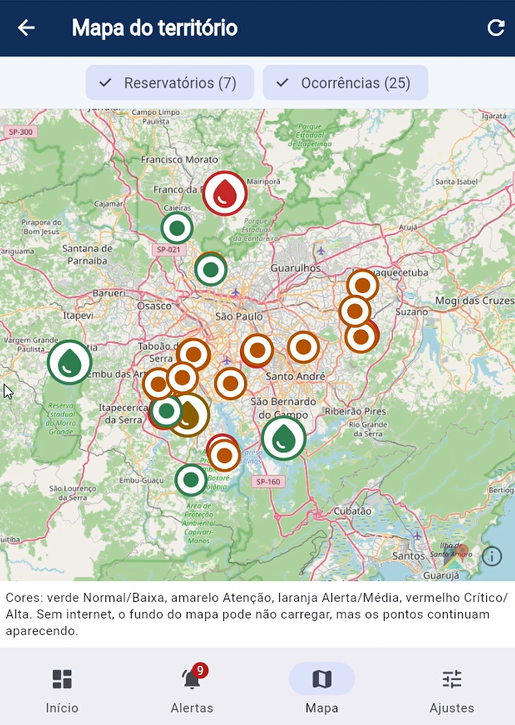<br>Mapa do território | 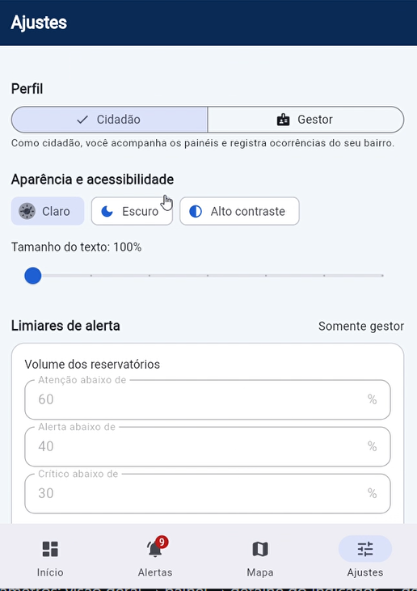<br>Limiares, tema e privacidade |
| 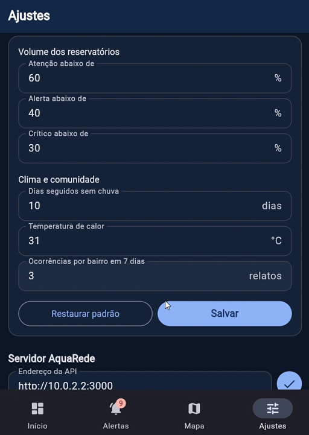<br>Volume dos reservatórios e Servidor| 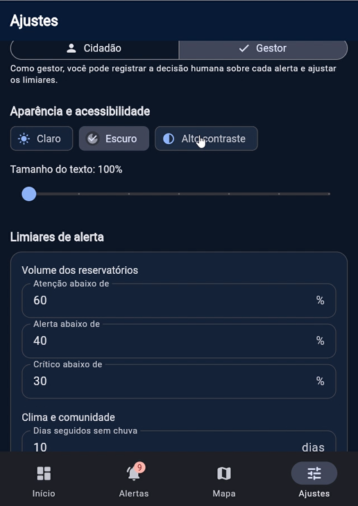<br>Tema escuro | 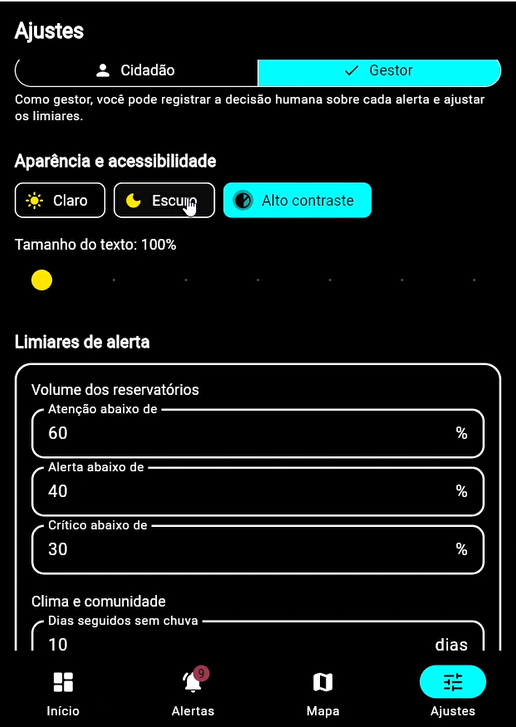<br>Alto contraste e fonte ampliada |

## 4. Funcionalidades

- [x] 11 telas com rotas nomeadas e passagem de parâmetros: visão geral → painel → detalhe do indicador → detalhe do alerta
- [x] 3 dashboards territoriais (mananciais, clima e ocorrências) com cards, gráficos, histórico e tendência
- [x] Alertas gerados por regras e projeções, cada um com evidências, nível de confiança, limitações e "quando não é confiável"
- [x] Aviso visível em todas as telas de alerta: os alertas apoiam, mas não substituem, a decisão humana
- [x] Registro da decisão humana pelo gestor (encaminhar, descartar ou em análise, com justificativa obrigatória)
- [x] Estado global compartilhado (Provider) e estado local nas telas (filtros, formulários, abas)
- [x] Estados de carregamento, erro (com "Tentar de novo") e lista vazia em todas as fontes
- [x] Consumo de API real (Open-Meteo), da API própria AquaRede (Node.js + MongoDB) e de serviço simulado (mananciais)
- [x] Persistência local: limiares, preferências, consentimento, avaliações, cache das APIs e ocorrências offline
- [x] Funciona sem conexão: usa o último cache e guarda ocorrências para enviar depois
- [x] Formulários com validação: registro de ocorrência, limiares de alerta, endereço do servidor e avaliação humana
- [x] Indicador de benefício social na tela inicial
- [x] Consentimento explícito, ocorrências anônimas e opção de revogar e apagar os dados
- [x] **Diferenciais:** dados reais (Open-Meteo), mapa com reservatórios e ocorrências, modo escuro e alto contraste, animações de transição, testes automatizados da lógica de alertas e das validações

## 5. Dados e alertas

### Fontes
| Painel | Fonte | Tipo |
|---|---|---|
| Clima local | [Open-Meteo](https://open-meteo.com): chuva diária e temperaturas máxima e mínima do centro de São Paulo (30 dias observados + 7 de previsão) | **Real**, pública e sem chave |
| Ocorrências | API AquaRede (`GET/POST /api/ocorrencias`), o servidor Node.js + Express + MongoDB feito em Application Development | **Real** (do próprio sistema). Sem servidor, o app usa o cache ou dados de exemplo **sintéticos** |
| Mananciais | Serviço simulado com série **sintética** de 365 dias para 7 sistemas produtores, inspirada no comportamento sazonal da RMSP | **Sintético**, indicado em todas as telas |

### Como os alertas são gerados
Os alertas são calculados em `lib/logic/motor_alertas.dart`, uma função pura e testada. Os limiares podem ser alterados pelo gestor em Ajustes.

| Alerta | Regra | Confiança |
|---|---|---|
| **Mananciais** | Faixa pelo volume atual e pela projeção em 30 dias (regressão linear dos últimos 30 dias): Atenção < 60%, Alerta < 40%, Crítico < 30%. Uma queda de 3 p.p. ou mais em 30 dias também gera Atenção. | 0,4 + 0,5 × R² da tendência, com desconto para dados antigos ou sintéticos |
| **Estiagem** | Dias seguidos com menos de 1 mm de chuva ≥ limiar (padrão 10). Alerta com o dobro do limiar e pouca chuva prevista. | 80% com 25 ou mais dias observados; 60% com menos |
| **Calor e consumo** | Máxima prevista para 3 dias ≥ limiar (padrão 31 °C) e menos de 10 mm previstos em 7 dias | 65% (previsão de curto prazo) |
| **Ocorrências** | Relatos no bairro em 7 dias ≥ limiar (padrão 3) = Alerta; o dobro = Crítico. Um relato de água contaminada = Alerta; dois = Crítico. | 0,4 + 0,1 por relato, até 90% |

### Métricas exibidas
Volume (%), tendência de 30 dias (p.p.), projeção de 30 dias com margem, R², dias até a faixa crítica, chuva acumulada de 30 dias, dias sem chuva, chuva e máxima previstas, relatos por dia, por tipo e por bairro, e pessoas afetadas.

### Limitações, vieses e quando as previsões não são confiáveis
- A projeção dos mananciais é **linear**: supõe que o ritmo dos últimos 30 dias continua, e não considera chuva futura, consumo ou transferências. Não é confiável com R² abaixo de 50%, na virada da estação chuvosa ou em mudanças de operação.
- O clima vem de **um único ponto** (centro de SP) e pode não refletir a chuva nas bacias dos reservatórios.
- As ocorrências **não são verificadas no local**. Bairros onde o app é pouco usado tendem a aparecer menos (**viés de subnotificação**), e vizinhos relatando o mesmo problema podem gerar **duplicidade**.
- Os dados de mananciais do protótipo são **sintéticos**. Na versão real, viriam do Portal dos Mananciais da Sabesp, como no notebook de Data Science do grupo.
- **Nenhum alerta dispara ação automática.** Toda decisão de alto impacto, como restrição de abastecimento, cabe a um gestor humano, que registra a decisão e a justificativa no app.

## 6. Privacidade e inclusão

**Privacidade**
- Consentimento explícito no primeiro uso, com explicação de quais dados são usados.
- Ocorrências **anônimas**: não há nome, telefone, e-mail, localização do aparelho nem endereço exato, só o bairro. O formulário bloqueia textos com e-mail, telefone ou CPF e pede uma confirmação de que não há dados pessoais.
- Os dados ficam no aparelho (shared_preferences). Em Ajustes, o usuário pode **revogar o consentimento e apagar tudo**.

**Acessibilidade e inclusão**
- Três temas: claro, escuro e **alto contraste** (amarelo e ciano sobre preto, bordas reforçadas).
- **Tamanho de texto** ajustável de 100% a 160%, somado ao ajuste do sistema.
- Leitores de tela: gráficos têm resumo em texto, cartões e marcadores do mapa têm rótulos descritivos, e mensagens de erro e carregamento são anunciadas.
- O nível nunca depende só da cor: todo selo traz texto e ícone.
- Áreas de toque de pelo menos 48 px e layout responsivo (grade de 2 colunas no celular e 4 no tablet).

## 7. Tecnologias e decisões técnicas

| Escolha | Por quê |
|---|---|
| **Flutter 3.35+ / Dart 3** | Um código para Android e iOS, com Material 3 |
| **provider** | Gerenciamento de estado simples e indicado pela documentação do Flutter. `ConfiguracoesProvider` (preferências, limiares, perfil) e `TerritorioProvider` (dados, status e alertas) são globais. Filtros, abas e formulários usam estado local (`StatefulWidget`). |
| **http** | Consumo das APIs REST (Open-Meteo e AquaRede), com timeout e fallback |
| **shared_preferences** | Persistência leve de JSON: cache das APIs, ocorrências offline, limiares, avaliações e preferências |
| **fl_chart** | Gráficos de linha e de barras com limiares e projeção |
| **flutter_map + latlong2** | Mapa com OpenStreetMap, sem chave de API e sem custo |
| **Arquitetura em camadas** | `models` (dados) → `services` (APIs e armazenamento) → `logic` (indicadores, alertas e validações, código puro e testável) → `state` (providers) → `screens` e `widgets` (interface). Tema e componentes ficam centralizados em `core/app_theme.dart` e `widgets/`. |

```
lib/
├── core/        tema, espaçamentos, rotas, formatadores
├── models/      ocorrência, manancial, clima, alerta, limiares
├── services/    Open-Meteo, API AquaRede, mananciais simulado, armazenamento local
├── logic/       indicadores, regressão linear, motor de alertas, validadores
├── state/       providers globais
├── widgets/     componentes reutilizáveis (cartões, selos, gráficos, estados)
└── screens/     telas
test/            testes do motor de alertas e das validações
```

## 8. Como executar

Pré-requisitos: Flutter 3.35 ou superior e um emulador Android ou aparelho físico.

```bash
git clone https://github.com/SEU-USUARIO/aquarede-app.git
cd aquarede-app
flutter create . --platforms=android,ios --project-name aquarede   # gera as pastas de plataforma
flutter pub get
flutter test        # roda os testes
flutter run
```

**Permissões no Android.** Em `android/app/src/main/AndroidManifest.xml`, adicione dentro de `<manifest>`:
```xml
<uses-permission android:name="android.permission.INTERNET"/>
```
E, para acessar o servidor local por `http`, adicione dentro de `<application>`:
```xml
android:usesCleartextTraffic="true"
```

**Servidor AquaRede (opcional).** Para ver as ocorrências reais, rode o projeto de Application Development (`npm start`, porta 3000). No emulador Android, o endereço padrão `http://10.0.2.2:3000` já aponta para o seu computador. Em um aparelho físico, troque o endereço em Ajustes pelo IP do computador na rede, por exemplo `http://192.168.0.10:3000`. Sem o servidor, o app funciona com cache ou dados de exemplo.

**Variáveis de ambiente.** Não há chaves de API: o Open-Meteo e o OpenStreetMap são abertos.

## 9. Vídeo

[Assista à demonstração (até 3 minutos)](https://LINK-DO-VIDEO)

## 10. Licença

Projeto acadêmico desenvolvido para a FIAP, Global Solution 2026.2, Cross-Platform Application Development. Uso educacional.
